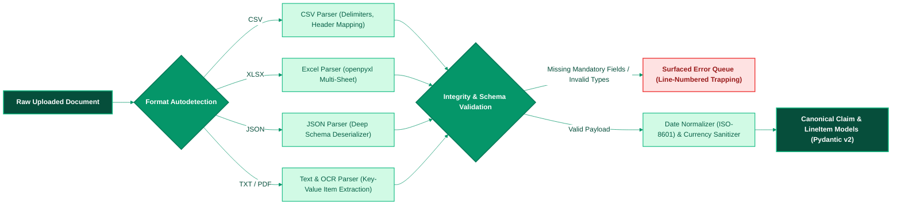
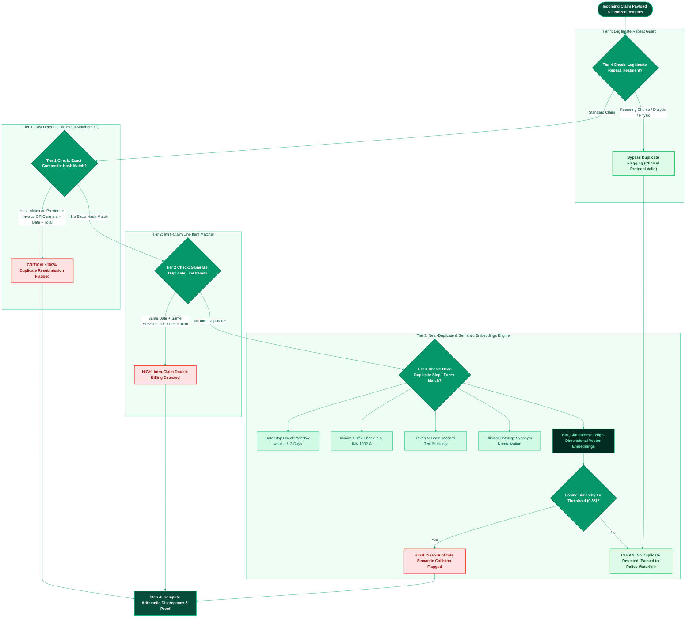
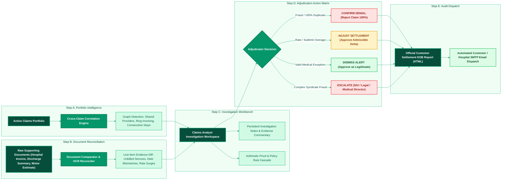
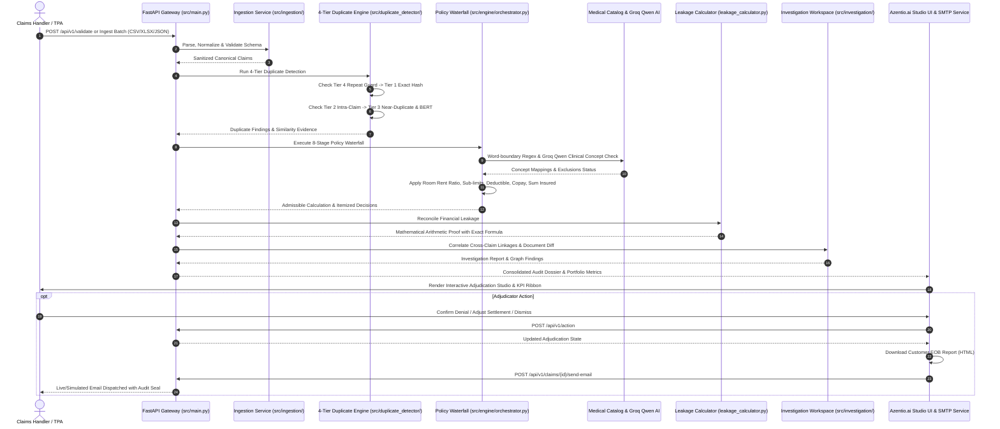

# Azentio.ai — Insurance Claims Intelligence & Financial Leakage Prevention Studio

<div align="center">


**Autonomous, Explainable & Enterprise-Grade Claims Adjudication Platform**  
*Azentio Hackathon 2026: AI for Insurance Claims Intelligence & Financial Leakage Prevention*

[Architecture](#-end-to-end-unified-architecture) • [Duplicate Detection Flow](#-step-3-4-tier-duplicate-detection--clinical-embeddings) • [Policy Waterfall Flow](#-step-2-policy-rule-waterfall-engine) • [Investigation Lifecycle](#-level-2--level-3-cross-claim-correlation--investigation-workspace) • [Quick Start](#-quick-start--verification)

</div>

---

## 📑 Table of Contents
1. [Executive Summary & Problem Statement](#-executive-summary--problem-statement)
2. [End-to-End Unified Architecture](#-end-to-end-unified-architecture)
3. [Step 1: Multi-Format Claims Ingestion](#-step-1-multi-format-claims-ingestion)
4. [Step 2: Policy Rule Waterfall Engine](#-step-2-policy-rule-waterfall-engine)
5. [Step 3: 4-Tier Duplicate Detection & Clinical Embeddings](#-step-3-4-tier-duplicate-detection--clinical-embeddings)
6. [Step 4: Financial Leakage Assessment & Arithmetic Proofs](#-step-4-financial-leakage-assessment--arithmetic-proofs)
7. [Step 5: Azentio.ai Claims Alert Dashboard & Adjudication Studio](#-step-5-azentioai-claims-alert-dashboard--adjudication-studio)
8. [Level 2 & Level 3: Cross-Claim Correlation & Investigation Workspace](#-level-2--level-3-cross-claim-correlation--investigation-workspace)
9. [Complete End-to-End Validation & Audit Sequence](#-complete-end-to-end-validation--audit-sequence)
10. [REST API Specification](#-rest-api-specification)
11. [Repository Structure](#-repository-structure)
12. [Configuration & Environment Variables](#-configuration--environment-variables)
13. [Quick Start & Verification](#-quick-start--verification)
14. [Test Suite & Benchmark Verification](#-test-suite--benchmark-verification)

---

## 📌 Executive Summary & Problem Statement

Insurance carriers process massive volumes of healthcare, motor, and general insurance claims consisting of multi-format invoices, hospital bills, pharmacy bills, and itemized receipts. Operational and financial leakage occurs when claims are overpaid due to:

- **Duplicate Submissions**: Identical invoice resubmissions or subtle near-duplicates with altered invoice numbers, date slop ($\pm 1\text{--}3$ days), or rounded amounts.
- **Double-Billed Line Items**: The same diagnostic test, consult, or imaging billed multiple times on a single hospital bill.
- **Policy Breaches**: Room rent breaches triggering mandatory proportionate deductions on associated surgeon and doctor fees.
- **Excluded Items**: Non-payable consumables (PPE, sanitizers, gloves, admin charges) disguised under clinical jargon.
- **Unapplied Cost-Sharing**: Overlooked annual deductibles, procedure sub-limits, or mandatory co-payments.
- **Exhausted Benefit Ceilings**: Payments exceeding remaining balance sum insured.
- **Provider Collusion & Phantom Billing**: Cross-claim correlation patterns revealing shared provider syndicates or overlapping hospitalization periods.

> [!IMPORTANT]
> **Azentio.ai** provides an automated, explainable, and enterprise-grade claims adjudication studio that connects **deterministic mathematical validation** with **semantic AI intelligence** to eliminate overpayments before settlement.

---

## 🏛 End-to-End Unified Architecture

The **Azentio.ai** architecture connects multi-format ingestion, 4-tier duplicate detection, an 8-stage IRDAI policy waterfall, arithmetic leakage proof generation, and a human-in-the-loop adjudication workbench:

```mermaid
%%{init: {
  'theme': 'base',
  'themeVariables': {
    'primaryColor': '#ecfdf5',
    'primaryTextColor': '#064e3b',
    'primaryBorderColor': '#059669',
    'lineColor': '#059669',
    'secondaryColor': '#d1fae5',
    'tertiaryColor': '#f0fdf4',
    'mainBkg': '#ecfdf5',
    'nodeBorder': '#059669',
    'clusterBkg': '#f0fdf4',
    'clusterBorder': '#10b981',
    'titleColor': '#064e3b',
    'edgeLabelBackground': '#ffffff'
  }
}}%%
flowchart TD
    classDef header fill:#064e3b,stroke:#10b981,stroke-width:2px,color:#ffffff,font-weight:bold;
    classDef emerald fill:#059669,stroke:#047857,stroke-width:2px,color:#ffffff,font-weight:bold;
    classDef lightGreen fill:#ecfdf5,stroke:#059669,stroke-width:1.5px,color:#064e3b;
    classDef mint fill:#d1fae5,stroke:#10b981,stroke-width:1.5px,color:#065f46;
    classDef aiDark fill:#022c22,stroke:#34d399,stroke-width:2px,color:#6ee7b7,font-weight:bold;
    classDef alertRed fill:#fee2e2,stroke:#ef4444,stroke-width:2px,color:#991b1b,font-weight:bold;
    classDef warnAmber fill:#fef3c7,stroke:#f59e0b,stroke-width:2px,color:#92400e,font-weight:bold;

    subgraph IngestionLayer ["1. Multi-Format Ingestion Layer"]
        RAW["Multi-Format Raw Claims Batch"]
        P1["CSV / Excel Parser (openpyxl)"]
        P2["JSON Nested Claims Ingester"]
        P3["Unstructured TXT & Document OCR"]
        NORM["Schema Normalizer & ISO-8601 Sanitizer"]
    end

    subgraph DuplicateLayer ["2. 4-Tier Duplicate & Semantic Detection Engine"]
        T4["Tier 4: Repeat Service Guard (Dialysis / Chemo / Physio)"]
        T1["Tier 1: Fast Exact Matcher (Deterministic Hash O(1))"]
        T2["Tier 2: Intra-Claim Line Item Matcher (Same-Bill Duplicates)"]
        T3["Tier 3: Near-Duplicate & Clinical Embeddings (Bio_ClinicalBERT)"]
    end

    subgraph WaterfallLayer ["3. IRDAI Policy Waterfall Adjudication Engine"]
        ST1["Stage 1: Eligibility & Waiting Period Gatekeeper"]
        ST2["Stage 2: Daily Room & ICU Rent Capping Ratio"]
        ST3["Stage 3: Consumables & Non-Payables Exclusions"]
        ST4["Stage 4: Proportionate Deduction Cascade"]
        ST5["Stage 5: Procedure & Disease Sub-Limit Capping"]
        ST6["Stage 6: Deductible Application"]
        ST7["Stage 7: Co-Payment Application"]
        ST8["Stage 8: Balance Sum Insured Ceiling Reconciliation"]
    end

    subgraph LeakageLayer ["4. Financial Leakage Assessment & Arithmetic Proofs"]
        DET_PROOFS["Exact Calculated Discrepancy (Deterministic ₹ Proof)"]
        SUSP_PROOFS["Suspected Leakage (Statistical Benchmark Anomaly ₹)"]
        FORMULA["Structured Audit Formula & Evidence Narrative"]
    end

    subgraph InvestigationLayer ["5. Advanced Investigation & Escalation Studio"]
        CORR["Cross-Claim Correlation Engine (Graph Linkage)"]
        DOC_DIFF["Document Reconciliation (Invoice vs Discharge vs Repair)"]
        ACTIONS["Analyst Action Center (Confirm Denial / Adjust / Dismiss)"]
    end

    subgraph DownstreamLayer ["6. Azentio.ai Studio & Downstream Ecosystem"]
        DASH["Azentio.ai Interactive Alert Dashboard"]
        EOB["Customer EOB Audit Report Generator (HTML)"]
        EMAIL["Live & Simulated SMTP Email Dispatcher"]
        API["OpenAI-Compatible REST Gateway (/v1/chat/completions)"]
    end

    RAW --> P1 & P2 & P3
    P1 & P2 & P3 --> NORM
    NORM --> T4
    T4 --> T1
    T1 --> T2
    T2 --> T3
    T3 --> ST1

    ST1 -->|Eligible Active Policy| ST2
    ST1 -->|Waiting Period Breach| REJ["REJECT CLAIM (100% Leakage Prevented)"]
    ST2 --> ST3 --> ST4 --> ST5 --> ST6 --> ST7 --> ST8

    ST8 --> DET_PROOFS & SUSP_PROOFS
    DET_PROOFS & SUSP_PROOFS --> FORMULA
    FORMULA --> CORR & DOC_DIFF
    CORR & DOC_DIFF --> ACTIONS

    ACTIONS --> DASH
    ACTIONS --> EOB
    ACTIONS --> EMAIL
    DASH --> API

    class RAW,NORM,ST8,DASH header;
    class P1,P2,P3,T1,T2,ST2,ST4,ST5,ST6,ST7,DET_PROOFS,CORR,DOC_DIFF emerald;
    class T4,ST3,SUSP_PROOFS,ACTIONS,EOB,EMAIL,API mint;
    class T3,FORMULA aiDark;
    class REJ alertRed;
```



---

## 📥 Step 1: Multi-Format Claims Ingestion

The ingestion service (`src/ingestion/`) processes heterogeneous raw claim formats with strict validation:



### Ingestion Capabilities & Integrity Safeguards:
- **Zero Silent Record Drops**: Corrupted rows or invalid amounts trigger precise, line-numbered diagnostic errors returned directly to the caller.
- **Automatic Format Detection**: Content sniffer distinguishes CSV, multi-tab Excel, deeply nested JSON, and unstructured hospital text bills.
- **Pydantic v2 Data Contracts**: Strong typing and validation on `Claim`, `Policy`, `LineItem`, `RuleResult`, and `ValidationReport`.
- **Pre-Packaged Samples**: Located under `data/samples/` (`sample_claims.csv`, `sample_claims.xlsx`, `sample_hospital_invoice.txt`, `sample_invalid_claim.csv`).

---

## ⚙️ Step 2: Policy Rule Waterfall Engine

Health insurance adjudication requires applying deductions in a mathematically strict sequence. Deducting co-pays or deductibles before exclusions produces mathematically incorrect payouts.

**Azentio.ai** enforces the official 8-stage **IRDAI Regulatory Waterfall Flow**:

```mermaid
%%{init: {
  'theme': 'base',
  'themeVariables': {
    'primaryColor': '#ecfdf5',
    'primaryTextColor': '#064e3b',
    'primaryBorderColor': '#059669',
    'lineColor': '#059669',
    'secondaryColor': '#d1fae5',
    'tertiaryColor': '#f0fdf4',
    'mainBkg': '#ecfdf5',
    'nodeBorder': '#059669',
    'clusterBkg': '#f0fdf4',
    'clusterBorder': '#10b981',
    'titleColor': '#064e3b',
    'edgeLabelBackground': '#ffffff'
  }
}}%%
flowchart TD
    classDef header fill:#064e3b,stroke:#10b981,stroke-width:2px,color:#ffffff,font-weight:bold;
    classDef emerald fill:#059669,stroke:#047857,stroke-width:2px,color:#ffffff,font-weight:bold;
    classDef mint fill:#d1fae5,stroke:#10b981,stroke-width:1.5px,color:#065f46;
    classDef calculation fill:#f0fdf4,stroke:#34d399,stroke-width:1.5px,color:#064e3b;
    classDef alertRed fill:#fee2e2,stroke:#ef4444,stroke-width:2px,color:#991b1b,font-weight:bold;
    classDef cleanGreen fill:#dcfce7,stroke:#22c55e,stroke-width:2px,color:#14532d,font-weight:bold;

    GROSS(["Total Billed Invoiced Amount (Gross Claim)"]) --> STAGE1{"Stage 1: Policy Eligibility & Waiting Periods"}

    STAGE1 -->|Policy Inactive or Initial 30-Day / PED Waiting Period Breach| REJECT["CLAIM REJECTED (100% Inadmissible - Leakage Prevented)"]
    STAGE1 -->|Policy Active & Eligible| STAGE2["Stage 2: Daily Room & ICU Rent Capping"]

    STAGE2 --> CALC_RATIO["Ratio = Allowed Daily Room Cap / Actual Daily Room Rate"]
    CALC_RATIO --> STAGE3["Stage 3: Consumables & Non-Payables Exclusions"]

    STAGE3 --> EXCL_ITEMS["Deduct Non-Payables: PPE, Gloves, Registration, Admin Charges"]
    EXCL_ITEMS --> STAGE4["Stage 4: Proportionate Deduction Cascade"]

    STAGE4 --> CALC_PROP["Admissible Fee = Billed Fee * Ratio (Surgeon, Nursing, Consultations)"]
    CALC_PROP --> STAGE5["Stage 5: Procedure & Disease Sub-Limit Enforcement"]

    STAGE5 --> CALC_SUBLIMIT["Cap Procedures: Cataract, Knee Replacement, Appendicitis"]
    CALC_SUBLIMIT --> STAGE6["Stage 6: Deductible Application"]

    STAGE6 --> CALC_DED["Current Admissible = max(0, Current Admissible - Deductible)"]
    CALC_DED --> STAGE7["Stage 7: Mandatory Co-Payment Deduction"]

    STAGE7 --> CALC_COPAY["Current Admissible = Current Admissible * (1 - Co-Payment %)"]
    CALC_COPAY --> STAGE8["Stage 8: Balance Sum Insured Ceiling Reconciliation"]

    STAGE8 --> CALC_BSI["Final Admissible = min(Current Admissible, Balance Sum Insured)"]
    CALC_BSI --> COMP{"Compare: Proposed Settlement vs Calculated Admissible"}

    COMP -->|Proposed Settlement > Calculated Admissible| LEAK["★ Calculated Financial Leakage Prevented = Proposed - Calculated"]
    COMP -->|Proposed Settlement <= Calculated Admissible| CLEAN["✔ Zero Leakage (Approved as Admissible)"]

    class GROSS,STAGE2,STAGE3,STAGE4,STAGE5,STAGE6,STAGE7,STAGE8 header;
    class STAGE1,COMP emerald;
    class CALC_RATIO,EXCL_ITEMS,CALC_PROP,CALC_SUBLIMIT,CALC_DED,CALC_COPAY,CALC_BSI calculation;
    class REJECT,LEAK alertRed;
    class CLEAN cleanGreen;
```



### Mathematical Specifications:

1. **Room Rent Proportionate Ratio**:
   $$\text{Proportionate Ratio} = \min\left(1.0, \frac{\text{Allowed Daily Limit}}{\text{Actual Daily Billed Rate}}\right)$$

2. **Associate Medical Fees Scaling**:
   $$\text{Admissible Fee} = \text{Billed Fee} \times \text{Proportionate Ratio}$$

3. **Financial Leakage Formula**:
   $$\text{Prevented Leakage} = \max\left(0, \text{Proposed Settlement} - \text{Calculated Settlement}\right)$$

---

## 🔎 Step 3: 4-Tier Duplicate Detection & Clinical Embeddings

The duplicate detection engine (`src/duplicate_detector/`) detects fraudulent or erroneous resubmissions across four complementary tiers without flagging valid recurring clinical treatments:



### Detection Tiers Deep-Dive:

| Tier | Module | Strategy | Detection Scope |
| :--- | :--- | :--- | :--- |
| **Tier 1** | `exact_matcher.py` | Composite deterministic key hashing $O(1)$ | 100% duplicate claim resubmissions and cross-claim duplicate invoices. |
| **Tier 2** | `intra_claim_matcher.py` | Pairwise line item comparison within the same claim | Intra-claim double billing (e.g., duplicate ECG or Chest X-Ray on the same day). |
| **Tier 3** | `fuzzy_matcher.py` + `bert_embedder.py` | Token N-grams + `Bio_ClinicalBERT` cosine similarity | Near-duplicates with modified invoice IDs, date slop ($\pm 3$ days), or clinical jargon aliases (`Arthroplasty` $\leftrightarrow$ `Knee Replacement`). |
| **Tier 4** | `repeat_guard.py` | Clinical frequency rule & episode guard | Protects legitimate recurring sessions (chemotherapy cycles, hemodialysis, physiotherapy). |

---

## 🧮 Step 4: Financial Leakage Assessment & Arithmetic Proofs

Step 4 bridges detection and audit by generating formal mathematical proofs for every flagged issue (`src/duplicate_detector/leakage_calculator.py`):

### 1. Calculated Discrepancy (Deterministic ₹ Proof)
Used when policy terms or duplicate billing define the exact excess amount:
- **Duplicate Resubmission**:
  $$\text{Discrepancy} = 1.0 \times \text{Total Invoiced Amount} = ₹32,000$$
- **Room Rent Breach**:
  $$\text{Discrepancy} = (\text{Billed Rate} - \text{Daily Limit}) \times \text{Days} = (₹7,500 - ₹5,000) \times 4 = ₹10,000$$

### 2. Suspected Leakage (Statistical Benchmark Anomaly ₹)
Used for price outliers requiring human auditor review:
- Regional pricing benchmarks identify procedures billed above normative percentiles without invalidating deterministic claims math.

### 3. Structured Arithmetic Proof Schema:
```json
{
  "finding_id": "FIND-CLM-001-EXACT-01",
  "formula": "calculated_discrepancy = 1.0 * total_claimed_amount",
  "input_values": {
    "total_claimed_amount": 32000.0,
    "original_settled_claim_id": "CLM-HIST-9021"
  },
  "calculated_discrepancy": 32000.0,
  "explanation": "Claim CLM-001 is a 100% exact duplicate of settled claim CLM-HIST-9021 from Provider H-102."
}
```

---

## 🖥️ Step 5: Azentio.ai Claims Alert Dashboard & Adjudication Studio

The web application (`static/index.html`) is an enterprise UI built with Tailwind CSS, Chart.js, and Google Fonts:

- **Executive KPI Ribbon**: Real-time display of total claims, billed volume, exact prevented leakage, suspected leakage, and flag rate.
- **Interactive Visual Analytics**:
  - *Doughnut Chart*: Breakdown of leakage exposure across scenarios.
  - *Bar Chart*: Severity and review status distribution.
  - *Provider Breakdown*: Hospital-wise claims volume and prevented overpayments.
- **Multi-Dimensional Filters**: Filter claims by severity (Critical, High, Medium, Clean), scenario (Exact Duplicate, Intra-Claim Duplicate, Near Duplicate, Room Rent Breach, Consumable Exclusion), hospital provider, or free-text search.
- **Drilldown Adjudication View**:
  - Patient timeline, hospital info, ICD-10 code, and tenure.
  - Arithmetic Proof card detailing the formula, input values, and clinical similarity score.
  - Complete 8-stage settlement financial waterfall table.
  - Itemized line items table with per-line status pills.
  - AI clinical notes powered by Groq Qwen (`qwen/qwen3.8-27b`).
- **Adjudicator Action Center & Customer Report Export**:
  - **Confirm Denial**: Rejects 100% of duplicate / unauthorized claims.
  - **Adjust Settlement**: Confirms adjusted admissible entitlement.
  - **Dismiss Alert**: Approves claim as legitimate exception.
  - **📥 Download Customer Report**: Generates and downloads an official Explanation of Benefits (EOB) audit document (`Azentio_Settlement_Report_{claim_id}.html`) ready to send to policyholders and hospitals.
  - **📧 Email Customer Report**: Dispatches the official EOB report and digital audit certificate directly to the policyholder's inbox via live SMTP or persistent simulated audit archive (`data/dispatched_emails/`).

---

## 🕵️ Level 2 & Level 3: Cross-Claim Correlation & Investigation Workspace

Beyond single-claim evaluation, **Azentio.ai** provides advanced cross-claim correlation and document evidence reconciliation:



---

## 🔄 Complete End-to-End Validation & Audit Sequence

The sequence below illustrates the complete lifecycle from claim submission to customer notification:



---

## 🌐 REST API Specification

| Endpoint | Method | Description |
| :--- | :---: | :--- |
| `/health` | `GET` | Service health, Groq model readiness, and canonical ingestion availability. |
| `/v1/models` | `GET` | OpenAI-compatible models list (`qwen/qwen3.8-27b`, `Bio_ClinicalBERT`). |
| `/v1/chat/completions` | `POST` | OpenAI-compatible LLM endpoint routing to Groq Qwen or deterministic fallback. |
| `/api/v1/claims` | `GET` | Active claims portfolio with validation status, leakage totals, and reviews. |
| `/api/v1/kpis` | `GET` | Executive metrics: flag rate, prevented leakage, provider distribution. |
| `/api/v1/validate` | `POST` | Validates a claim payload through the 8-stage policy waterfall. |
| `/api/v1/validate-demo/{id}` | `POST` | Adjudicates one of the 9 pre-configured demo benchmark cases. |
| `/api/v1/claims/{id}/adjudicate` | `GET` | Full dossier: arithmetic proofs, waterfall breakdown, line decisions. |
| `/api/v1/action` | `POST` | Persists adjudicator decisions (`CONFIRM_DENIAL`, `ADJUST_AMOUNT`, `DISMISS`). |
| `/api/v1/investigation/{id}/correlations` | `GET` | Runs graph cross-claim correlation on the active portfolio. |
| `/api/v1/investigation/{id}/compare-document`| `POST` | Reconciles claim line items against raw hospital tax invoices or estimates. |
| `/api/v1/claims/{id}/report` | `GET` | Generates official Explanation of Benefits (EOB) HTML audit document. |
| `/api/v1/claims/{id}/send-email` | `POST` | Dispatches settlement EOB document to customer inbox via SMTP. |

---

## 📂 Repository Structure

```
Azentio_Hackathon-/
├── app.py                            # Unified application runner with auto-browser launch
├── architecture.md                   # Microservice architecture and waterfall specifications
├── ProblemStatement.md               # Azentio Hackathon official problem requirements
├── README.md                         # Enterprise platform documentation & architecture diagrams
├── requirements.txt                  # Python dependencies (FastAPI, Scikit-learn, etc.)
├── run_detection_benchmark.py        # Benchmark verification script
│
├── src/
│   ├── main.py                       # FastAPI REST Gateway & OpenAI-compatible routes
│   ├── config.py                     # Environment variables & runtime settings
│   ├── repository.py                 # In-memory claims portfolio store & demo seeding
│   ├── report_generator.py           # Explanation of Benefits (EOB) HTML generator
│   ├── email_service.py              # Live SMTP & simulated email dispatch system
│   │
│   ├── ai/
│   │   └── groq_client.py            # Groq Qwen 3.8-27B contextual clinical reasoning agent
│   │
│   ├── catalog/
│   │   └── medical_catalog.py        # Word-boundary regex catalog for IRDAI exclusions
│   │
│   ├── duplicate_detector/
│   │   ├── engine.py                 # Multi-tier duplicate detector orchestrator
│   │   ├── leakage_calculator.py     # Deterministic arithmetic proof generator
│   │   ├── tiers/
│   │   │   ├── exact_matcher.py      # Tier 1: Deterministic composite hash matcher O(1)
│   │   │   ├── intra_claim_matcher.py# Tier 2: Same-bill line item duplicate detector
│   │   │   ├── fuzzy_matcher.py      # Tier 3: N-Gram Jaccard & date slop matcher
│   │   │   └── repeat_guard.py       # Tier 4: Recurring treatment episode protector
│   │   └── embeddings/
│   │       ├── bert_embedder.py      # Bio_ClinicalBERT high-dimensional vector embeddings
│   │       └── tokenizer.py          # Clinical ontology medical concept tokenizer
│   │
│   ├── engine/
│   │   └── orchestrator.py           # 8-Stage IRDAI waterfall execution engine
│   │
│   ├── ingestion/
│   │   ├── service.py                # Multi-format ingestion coordinator
│   │   ├── parsers.py                # CSV, Excel, JSON, and raw text document parsers
│   │   └── validators.py             # Schema, date ISO-8601, and currency validators
│   │
│   ├── investigation/
│   │   ├── correlation.py            # Level 2 Cross-claim correlation graph analyzer
│   │   ├── document_comparator.py    # Level 2 Document OCR line-item diff analyzer
│   │   └── analyst_service.py        # Level 3 Analyst investigation workspace & actions
│   │
│   ├── rules/                        # Individual deterministic IRDAI policy rules
│   │   ├── coverage.py               # Active policy & waiting periods (30-day, PED)
│   │   ├── exclusions.py             # Non-payable consumables & IRDAI exclusion lists
│   │   ├── sub_limits.py             # Room rent & ICU daily limits, disease caps
│   │   ├── proportionate.py          # Proportionate scaling of associate fees
│   │   ├── deductible.py             # Deductible application
│   │   ├── copay.py                  # Co-payment deduction
│   │   ├── benefit_limit.py          # Balance sum insured ceiling reconciliation
│   │   └── anomaly.py                # Regional pricing benchmark outlier detector
│   │
│   └── schemas/                      # Pydantic v2 data contracts
│       ├── claim.py                  # Claim, LineItem, IncidentDetails
│       ├── policy.py                 # Policy, Deductibles, CoPay, SubLimits
│       └── validation.py             # RuleResult, Summary, ValidationReport
│
├── static/
│   └── index.html                    # Azentio.ai Studio UI (Tailwind CSS, Chart.js)
│
├── data/
│   ├── samples/                      # Sample claims (CSV, XLSX, TXT, JSON, PDF)
│   ├── jury_examples/                # Step-by-step evaluation jury datasets
│   ├── synthetic/                    # Benchmark claims portfolio & ground truth
│   └── dispatched_emails/            # Persistent archive of customer settlement emails
│
└── tests/                            # Comprehensive Pytest Suite (34 Passing Tests)
    ├── test_duplicate_detector.py
    ├── test_clinical_embeddings.py
    ├── test_cross_claim_correlation.py
    ├── test_document_analysis.py
    ├── test_email_service.py
    ├── test_analyst_review.py
    └── policy_rules/
```

---

## ⚙️ Configuration & Environment Variables

Create or update `.env` in the repository root:

```env
# Application Port
PORT=8000

# Groq AI Model Configuration
GROQ_API_KEY=your_groq_api_key_here
GROQ_MODEL=qwen/qwen3.8-27b
GROQ_BASE_URL=https://api.groq.com

# SMTP Email Configuration (Optional - Live or Simulated Archive)
SMTP_HOST=smtp.gmail.com
SMTP_PORT=587
SMTP_USER=your_email@gmail.com
SMTP_PASSWORD=your_app_password
SMTP_FROM_EMAIL=claims-adjudication@azentio.ai
```

---

## 🚀 Quick Start & Verification

### 1. Set Up Environment
```bash
# Activate virtual environment
source .venv/bin/activate   # On Linux/macOS
# or: .venv\Scripts\activate on Windows

# Install dependencies
pip install -r requirements.txt
```

### 2. Launch Azentio.ai Studio
```bash
# Starts the server and opens your default browser automatically
python app.py

# Or launch directly with Uvicorn
uvicorn src.main:app --host 0.0.0.0 --port 8000
```

### 3. Explore the Adjudication Studio
- Navigate to `http://localhost:8000`.
- Click **"⚡ Load Demo Batch"** to load the comprehensive hackathon benchmark cases.
- Or click **"Ingest Claims File"** to upload your own CSV, Excel, JSON, or TXT bills.
- Click **"Audit"** on any flagged claim to inspect the arithmetic proofs and full 8-stage waterfall.
- Download the customer **EOB Settlement Report (HTML)** or dispatch it via email.

---

## 🧪 Test Suite & Benchmark Verification

Execute the complete pytest verification suite covering all 5 steps:

```bash
pytest tests -v
```

### Test Coverage Highlights:
- `tests/policy_rules/test_api.py`: FastAPI endpoints, health check, UI serving, portfolio lifecycle.
- `tests/policy_rules/test_ingestion.py`: CSV, Excel (.xlsx), JSON, and TXT parsing, validation, and error reporting.
- `tests/policy_rules/test_rules.py`: Coverage rules, exclusions, room rent caps, proportionate deductions, deductibles, co-pays, balance sum insured.
- `tests/test_duplicate_detector.py`: Exact duplicate claim detection, intra-claim line item matching, near-duplicate fuzzy matching, date slop, repeat guard.
- `tests/test_clinical_embeddings.py`: Clinical ontology tokenizer, TF-IDF vectorizer, BERT semantic embeddings, and cosine similarity.
- `tests/test_cross_claim_correlation.py`: Cross-claim link detection and suspicious provider rings.
- `tests/test_document_analysis.py`: Supporting document line-level OCR reconciliation diffs.
- `tests/test_email_service.py`: Customer EOB HTML generation and SMTP dispatch service.

**Verification Status**: **34 passed in ~6 seconds**.
