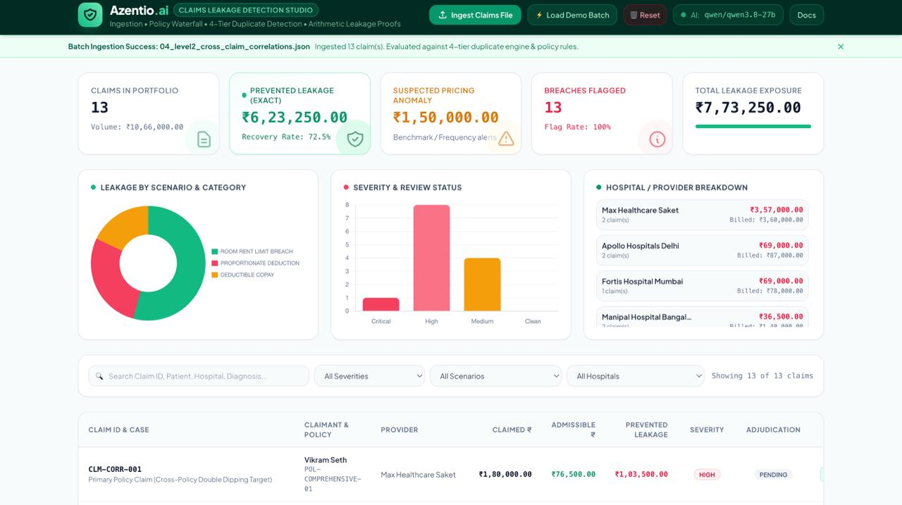
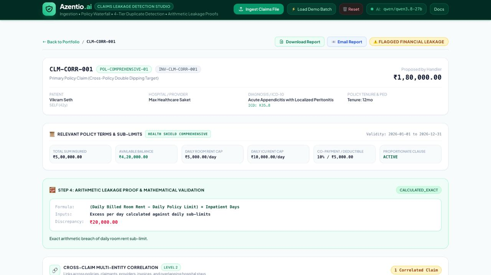
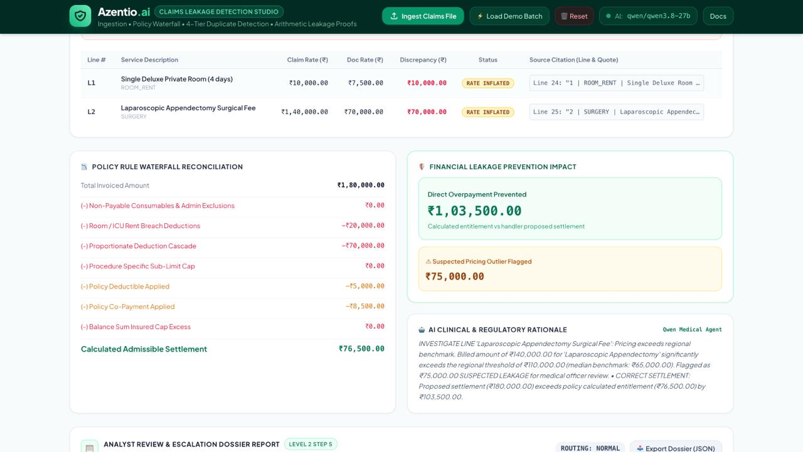
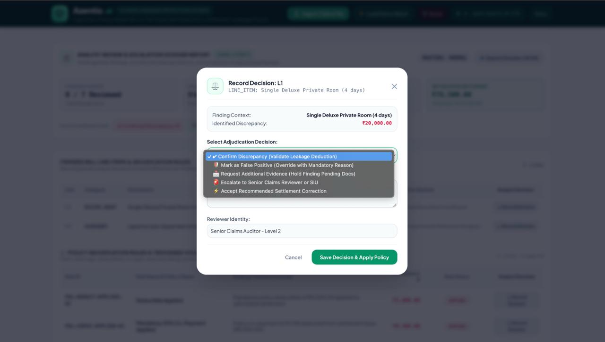
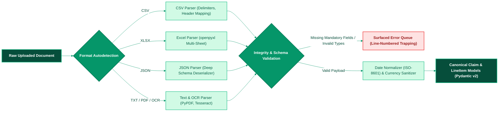
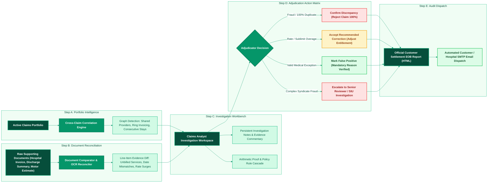
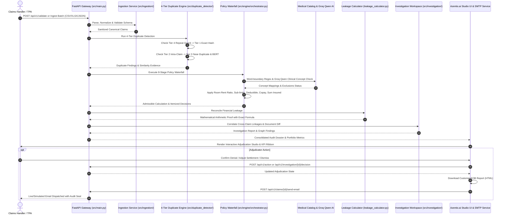

# Azentio.ai — Insurance Claims Intelligence, Forensic Investigation & Financial Leakage Prevention Studio

<div align="center">


**Autonomous, Explainable & Enterprise-Grade Claims Adjudication & Forensic Investigation Platform**  
*Azentio Hackathon 2026: AI for Insurance Claims Intelligence & Financial Leakage Prevention*

[Architecture](#-end-to-end-system-architecture) • [UI Visual Tour](#-platform-ui--forensic-investigation-tour) • [Level 1: Validation & Detection](#-level-1-claims-validation--leakage-detection) • [Level 2: Forensic Investigation](#-level-2-forensic-investigation--settlement-corrections) • [Jury Guide](#-jury-demonstration-guide--pre-packaged-datasets) • [API Reference](#-comprehensive-api-reference) • [Quick Start](#-quick-start--verification)

</div>

---

<div align="center">



*Figure 1: Azentio.ai Executive Studio — Live KPI Ribbon (₹6,23,250 Prevented Leakage, 72.5% Recovery Rate), Leakage Analytics by Scenario, Severity Distribution, and Active Claims Portfolio Table.*

</div>

---

## 📑 Table of Contents
1. [Executive Summary & Problem Statement](#-executive-summary--problem-statement)
2. [Platform UI & Forensic Investigation Tour](#-platform-ui--forensic-investigation-tour)
3. [End-to-End System Architecture](#-end-to-end-system-architecture)
4. [Level 1: Claims Validation & Leakage Detection](#-level-1-claims-validation--leakage-detection)
   - [Step 1: Multi-Format Claims Ingestion Pipeline](#step-1-multi-format-claims-ingestion-pipeline)
   - [Step 2: 8-Stage Policy Rule Waterfall Engine](#step-2-8-stage-policy-rule-waterfall-engine)
   - [Step 3: 4-Tier Duplicate Detection & Clinical Embeddings](#step-3-4-tier-duplicate-detection--clinical-embeddings)
   - [Step 4: Deterministic Arithmetic Discrepancy Proofs](#step-4-deterministic-arithmetic-discrepancy-proofs)
   - [Step 5: Interactive Alert Dashboard & Adjudication Studio](#step-5-interactive-alert-dashboard--adjudication-studio)
5. [Level 2: Forensic Investigation & Settlement Corrections](#-level-2-forensic-investigation--settlement-corrections)
   - [1. Cross-Claim Multi-Entity Correlation](#1-cross-claim-multi-entity-correlation)
   - [2. Supporting Document & Invoice Evidence Reconciliation](#2-supporting-document--invoice-evidence-reconciliation)
   - [3. Claims Investigation Workspace](#3-claims-investigation-workspace)
   - [4. Recommended Settlement Corrections](#4-recommended-settlement-corrections)
   - [5. Analyst Review & Escalation Dossier](#5-analyst-review--escalation-dossier)
6. [End-to-End Claims Validation & Audit Sequence](#-end-to-end-claims-validation--audit-sequence)
7. [Settlement Report & Explanation of Benefits (EOB)](#-settlement-report--explanation-of-benefits-eob)
8. [Jury Demonstration Guide & Pre-Packaged Datasets](#-jury-demonstration-guide--pre-packaged-datasets)
9. [Comprehensive API Reference](#-comprehensive-api-reference)
10. [Repository Structure](#-repository-structure)
11. [Configuration & Environment Variables](#-configuration--environment-variables)
12. [Quick Start & Verification](#-quick-start--verification)
13. [Automated Test Suite](#-automated-test-suite)

---

## 📌 Executive Summary & Problem Statement

Insurance carriers process massive volumes of healthcare, motor, and general claims submitted across varied, unstructured channels: paper invoices, hospital PDFs, scanned discharge summaries, Excel rosters, and API payloads. Significant operational and financial leakage occurs due to:

- **Duplicate Claims & Double Dipping**: Identical invoices submitted across different policies, or subtle near-duplicates with altered dates, split stays, or modified amounts.
- **Sub-Limit & Proportionate Breaches**: Billed room rent exceeding daily policy limits without cascading proportional deductions across associated surgeon and consultant charges.
- **Unsubstantiated & Disguised Charges**: Billed hospital items not present on the actual tax invoice, or non-payable consumables disguised under generic clinical jargon.
- **Unapplied Cost-Sharing**: Missed annual deductibles, co-payment percentages, or balance sum insured ceilings.
- **Cross-Claim Collusion**: High-velocity provider billing rings and split stay unbundling designed to bypass individual policy authorization limits.

> [!IMPORTANT]
> **Azentio.ai** combines **deterministic mathematical rule engines** with **Groq Qwen clinical intelligence**, **vector embeddings**, and **forensic document reconciliation** into a single unified claims studio in our emerald and mint green enterprise UI.

---

## 📸 Platform UI & Forensic Investigation Tour

Here is a visual walkthrough of the **Azentio.ai Claims Adjudication & Investigation Studio**:

### 1. Executive KPI Portfolio & Real-Time Analytics
<div align="center">


*Figure A: Portfolio overview featuring the Executive KPI Ribbon (₹6,23,250 Exact Leakage Prevented, ₹1,50,000 Suspected Pricing Outliers, 72.5% Recovery Rate), Leakage Breakdown Doughnut, Severity Distribution Bar Chart, Hospital Provider League, and Searchable Claim Ledger.*

</div>

---

### 2. Claims Investigation Workspace & Deterministic Arithmetic Proofs
<div align="center">



*Figure B: 360° Claims Dossier (`CLM-CORR-001`) displaying Patient clinical context (ICD-10 K35.8), Policy Terms & Sub-Limits summary card (₹5,00,000 Sum Insured, ₹5,000/day Room Rent Cap, Active Proportionate Clause), and Step 4 Deterministic Arithmetic Discrepancy Proof (`(Daily Billed Room Rent - Daily Policy Limit) × Inpatient Days = ₹20,000.00`).*

</div>

---

### 3. Financial Waterfall Reconciliation & AI Clinical Rationale
<div align="center">



*Figure C: Line-item evidence discrepancy ledger with verbatim source quotes, 8-Stage IRDAI Policy Waterfall Reconciliation card (Total Invoiced ₹1,80,000 $\rightarrow$ Admissible Settlement ₹76,500), Financial Leakage Prevention Impact (₹1,03,500 Direct Overpayment Prevented), and Groq Qwen AI Clinical & Regulatory Reasoning.*

</div>

---

### 4. Human-in-the-Loop Analyst Review & Adjudication Modal
<div align="center">



*Figure D: Adjudication Action Modal enforcing 5 regulatory decision options (`Confirm Discrepancy`, `Mark as False Positive with Mandatory Reason`, `Request Additional Evidence`, `Escalate to Senior Reviewer or SIU`, `Accept Recommended Correction`), recorded by Senior Claims Auditor - Level 2.*

</div>

---

## 🏛 End-to-End System Architecture

The **Azentio.ai** architecture connects Level 1 ingestion, duplicate detection, and policy waterfalls with Level 2 forensic cross-claim investigation and automated EOB dispatch:

```mermaid
%%{init: {
  'theme': 'base',
  'themeVariables': {
    'primaryColor': '#ecfdf5',
    'primaryTextColor': '#064e3b',
    'primaryBorderColor': '#059669',
    'lineColor': '#059669',
    'secondaryColor': '#d1fae5',
    'tertiaryColor': '#f0fdf4',
    'mainBkg': '#ecfdf5',
    'nodeBorder': '#059669',
    'clusterBkg': '#f0fdf4',
    'clusterBorder': '#10b981',
    'titleColor': '#064e3b',
    'edgeLabelBackground': '#ffffff'
  }
}}%%
flowchart TD
    classDef header fill:#064e3b,stroke:#10b981,stroke-width:2px,color:#ffffff,font-weight:bold;
    classDef emerald fill:#059669,stroke:#047857,stroke-width:2px,color:#ffffff,font-weight:bold;
    classDef lightGreen fill:#ecfdf5,stroke:#059669,stroke-width:1.5px,color:#064e3b;
    classDef mint fill:#d1fae5,stroke:#10b981,stroke-width:1.5px,color:#065f46;
    classDef aiDark fill:#022c22,stroke:#34d399,stroke-width:2px,color:#6ee7b7,font-weight:bold;
    classDef alertRed fill:#fee2e2,stroke:#ef4444,stroke-width:2px,color:#991b1b,font-weight:bold;
    classDef warnAmber fill:#fef3c7,stroke:#f59e0b,stroke-width:2px,color:#92400e,font-weight:bold;

    subgraph IngestionLayer ["1. Multi-Format Ingestion & Evidence Ingestion"]
        RAW["Multi-Format Raw Claims & Evidence Uploads"]
        P1["CSV / Excel Parser (openpyxl)"]
        P2["JSON Nested Ingestion & SQLite Staging"]
        P3["Unstructured TXT, Scanned PDFs & OCR"]
        NORM["Schema Normalizer & ISO-8601 Sanitizer"]
    end

    subgraph DuplicateLayer ["2. 4-Tier Duplicate & Semantic Detection Engine"]
        T4["Tier 4: Repeat Service Guard (Dialysis / Chemo / Physio)"]
        T1["Tier 1: Fast Exact Matcher (Deterministic Hash O(1))"]
        T2["Tier 2: Intra-Claim Line Item Matcher (Same-Bill Duplicates)"]
        T3["Tier 3: Near-Duplicate & Clinical Embeddings (Bio_ClinicalBERT)"]
    end

    subgraph WaterfallLayer ["3. IRDAI Policy Waterfall Adjudication Engine"]
        ST1["Stage 1: Eligibility & Waiting Period Gatekeeper"]
        ST2["Stage 2: Daily Room & ICU Rent Capping Ratio"]
        ST3["Stage 3: Consumables & Non-Payables Exclusions"]
        ST4["Stage 4: Proportionate Deduction Cascade"]
        ST5["Stage 5: Procedure & Disease Sub-Limit Capping"]
        ST6["Stage 6: Deductible Application"]
        ST7["Stage 7: Co-Payment Application"]
        ST8["Stage 8: Balance Sum Insured Ceiling Reconciliation"]
    end

    subgraph LeakageLayer ["4. Financial Leakage Assessment & Arithmetic Proofs"]
        DET_PROOFS["Exact Calculated Discrepancy (Deterministic ₹ Proof)"]
        SUSP_PROOFS["Suspected Leakage (Statistical Benchmark Anomaly ₹)"]
        FORMULA["Structured Audit Formula & Evidence Narrative"]
    end

    subgraph InvestigationLayer ["5. Level 2 Forensic Investigation & Workspace"]
        CORR["Cross-Claim Correlation Engine (Graph Linkage)"]
        DOC_DIFF["Forensic Document Comparator (Invoice vs Discharge vs Repair)"]
        WORKSPACE["Analyst Investigation Workspace & Policy Terms Registry"]
        ACTIONS["Analyst Action Center (5 Decisions, SIU Escalation)"]
    end

    subgraph DownstreamLayer ["6. Azentio.ai Studio & Downstream Ecosystem"]
        DASH["Azentio.ai Interactive Alert Dashboard"]
        EOB["Official EOB Settlement Audit Document (HTML)"]
        EMAIL["Live & Simulated SMTP Email Dispatcher"]
        API["OpenAI-Compatible REST Gateway (/v1/chat/completions)"]
    end

    RAW --> P1 & P2 & P3
    P1 & P2 & P3 --> NORM
    NORM --> T4
    T4 --> T1
    T1 --> T2
    T2 --> T3
    T3 --> ST1

    ST1 -->|Eligible Active Policy| ST2
    ST1 -->|Waiting Period Breach| REJ["REJECT CLAIM (100% Leakage Prevented)"]
    ST2 --> ST3 --> ST4 --> ST5 --> ST6 --> ST7 --> ST8

    ST8 --> DET_PROOFS & SUSP_PROOFS
    DET_PROOFS & SUSP_PROOFS --> FORMULA
    FORMULA --> CORR & DOC_DIFF
    CORR & DOC_DIFF --> WORKSPACE
    WORKSPACE --> ACTIONS

    ACTIONS --> DASH
    ACTIONS --> EOB
    ACTIONS --> EMAIL
    DASH --> API

    class RAW,NORM,ST8,DASH header;
    class P1,P2,P3,T1,T2,ST2,ST4,ST5,ST6,ST7,DET_PROOFS,CORR,DOC_DIFF,WORKSPACE emerald;
    class T4,ST3,SUSP_PROOFS,ACTIONS,EOB,EMAIL,API mint;
    class T3,FORMULA aiDark;
    class REJ alertRed;
```



---

## 🛡️ Level 1: Claims Validation & Leakage Detection

### Step 1: Multi-Format Claims Ingestion Pipeline

The ingestion service (`src/ingestion/` & `claims-ingestion/`) processes heterogeneous raw claim formats with strict validation:



- **Format Autodetection**: Ingests `.csv`, `.xlsx`, `.json`, `.txt`, `.pdf`, `.png`, and `.jpg` files without pre-processing.
- **Canonical Pipeline (`claims-ingestion/`)**: Multi-format staging with SQLite persistence, OCR text extraction, referential integrity checks, and line-level error trapping so bad records are flagged with exact line numbers rather than silently dropped.
- **Folder Upload**: Native directory picker allows selecting an entire demo folder (`data/jury_examples/`) with 1 click.

---

### Step 2: 8-Stage Policy Rule Waterfall Engine

Health insurance adjudication requires applying deductions in a mathematically strict sequence. Deducting co-pays or deductibles before exclusions produces mathematically incorrect payouts.

**Azentio.ai** enforces the official 8-stage **IRDAI Regulatory Waterfall Flow**:


#### Mathematical Formulas:
1. **Room Rent Proportionate Ratio**:
   $$\text{Proportionate Ratio} = \min\left(1.0, \frac{\text{Allowed Daily Limit}}{\text{Actual Daily Billed Rate}}\right)$$

2. **Associate Medical Fees Scaling**:
   $$\text{Admissible Fee} = \text{Billed Fee} \times \text{Proportionate Ratio}$$

3. **Prevented Financial Leakage**:
   $$\text{Prevented Leakage} = \max\left(0, \text{Proposed Settlement} - \text{Calculated Settlement}\right)$$

---

### Step 3: 4-Tier Duplicate Detection & Clinical Embeddings

The duplicate detection engine (`src/duplicate_detector/`) detects fraudulent or erroneous resubmissions across four complementary tiers without flagging valid recurring clinical treatments:


- **Tier 1 (Fast Exact Matcher)**: $O(1)$ composite hash matching `(provider_id + invoice_number)` and `(claimant_id + date + amount)`.
- **Tier 2 (Intra-Claim Line Item Matcher)**: Catches double-billing on the same invoice (e.g., duplicated diagnostics or laboratory tests).
- **Tier 3 (Near-Duplicate & Semantic Matcher)**: Detects altered invoices (e.g. invoice suffix `-B`, date slop $\pm 1\text{--}3$ days) using `Sentence-Transformers` (`all-MiniLM-L6-v2`) and clinical ontology tokenization (`Arthroplasty` $\leftrightarrow$ `Knee Replacement`).
- **Tier 4 (Repeat Service Guard)**: Protects valid recurring treatments (dialysis, chemotherapy, physiotherapy) from false-positive flags.

---

### Step 4: Deterministic Arithmetic Discrepancy Proofs

Generates a formal mathematical breakdown for every discrepancy:
- **Formula**: Exact algebraic expression applied.
- **Input Variables**: Real monetary values and parameters inserted.
- **Calculated Leakage**: Exact numerical excess.
- **Audit Explanation**: Clear, human-readable narrative.

<div align="center">


*Figure 2: Step 4 Deterministic Arithmetic Discrepancy Proof Card displaying exact algebraic equation, variable inputs, and ₹20,000.00 room rent overage.*

</div>

```json
{
  "finding_id": "FIND-CLM-001-EXACT-01",
  "formula": "calculated_discrepancy = 1.0 * total_claimed_amount",
  "input_values": {
    "total_claimed_amount": 32000.0,
    "original_settled_claim_id": "CLM-HIST-9021"
  },
  "calculated_discrepancy": 32000.0,
  "explanation": "Claim CLM-001 is a 100% exact duplicate of settled claim CLM-HIST-9021 from Provider H-102."
}
```

---

### Step 5: Interactive Alert Dashboard & Adjudication Studio

<div align="center">


*Figure 3: Adjudication Studio View — Line-item rate inflation table with source citations, 8-stage financial waterfall reconciliation box, and Qwen AI clinical rationale.*

</div>

- **KPI Ribbon**: Total portfolio billed, exact prevented leakage, suspected leakage, flag rate.
- **Visual Analytics**: Chart.js charts for leakage by scenario, severity breakdown, and hospital provider distribution.
- **Drilldown View**: Patient timeline, ICD-10 codes, arithmetic proof box, policy waterfall, and Qwen AI clinical rationale.

---

## 🔍 Level 2: Forensic Investigation & Settlement Corrections



### 1. Cross-Claim Multi-Entity Correlation
Builds multi-dimensional linkages across policies, claimants, providers, invoices, and incidents:
- **Cross-Policy Double Dipping**: Detects the same hospital invoice number submitted under two distinct policies (`CLM-CORR-001` vs `CLM-CORR-002`).
- **Overlapping Hospitalization**: Identifies physically impossible concurrent inpatient stays for the same patient at different hospitals (`CLM-CORR-003` vs `CLM-CORR-004`).
- **Split Incident Stay Unbundling**: Detects consecutive stays within 48 hours for the same condition artificially split into two claims to stay beneath individual approval limits.
- **High-Velocity Provider Collusion**: Identifies sudden clusters of high-value claims submitted by the same hospital within hours.
- **Recycled Invoices Across Patients**: Uncovers fraudulent recycling of identical hospital invoice numbers across unrelated claimants.
- **Interactive Graph**: Generates nodes (Claim, Claimant, Provider, Invoice) and directed edges showing connection type and severity.

### 2. Supporting Document & Invoice Evidence Reconciliation
Extracts and cross-verifies sample supporting documents (hospital tax invoices, discharge summaries, repair estimates) against submitted claim data:
- **Variance Detection**: Identifies total amount mismatches, admission/discharge date discrepancies, and ICD-10 diagnosis discrepancies.
- **Line-Level Unit Rate Inflation**: Matches itemized invoice tables to detect rate inflation (e.g., surgeon fee billed at ₹80,000 in claim vs ₹70,000 on hospital invoice).
- **Unsubstantiated Charges**: Flags phantom billed items not found anywhere in the supporting document.
- **Verbatim Source Citations**: Every variance retains exact source document name, section, line number, and raw quote for forensic evidence.

### 3. Claims Investigation Workspace
Consolidates all evidence into an integrated 360° workspace for the claims auditor:
- **Relevant Policy Terms & Sub-Limits Card**: Displays sum insured, balance sum insured, daily room/ICU caps, co-pay %, deductible, and proportionate clause status.
- **Raw Document Inspector (`#rawDocModal`)**: Verbatim full-text document viewer with line count and size metrics.
- **Adjudicator Working Notes Center**: Supports drafting interim notes during ongoing investigation (`POST /api/v1/investigation/{claim_id}/notes`) without prematurely closing the claim.

### 4. Recommended Settlement Corrections
Replaces generic warnings with specific, actionable adjustments:
- Shows **Original Amount**, **Corrected Amount**, **Adjustment Amount**, **Calculation Formula**, and **Policy Rule / Evidence Citation**.
- Covers non-payable consumable removals, room rent capping, proportionate scaling, procedure caps, deductibles, and co-payments.

### 5. Analyst Review & Escalation Dossier
Enforces full regulatory decision workflows on every finding:

<div align="center">


*Figure 4: Analyst Review & Decision Modal — Live demonstration of recorded finding decision with 5 supported actions and reviewer identity tagging.*

</div>

- **5 Supported Decisions**:
  1. `Confirm Discrepancy`: Validates leakage deduction as audited fact.
  2. `Mark as False Positive (with Reason)`: Enforces **mandatory justification reason** (API rejects empty reasons). Automatically credits back the discrepancy to the claimant.
  3. `Request Additional Evidence`: Places finding in pending review state while requesting supporting documentation.
  4. `Escalate to Senior Reviewer or SIU`: Routes finding to `SENIOR_CLAIMS_REVIEWER` or `SPECIAL_INVESTIGATION_UNIT` (SIU). Activates the `ROUTING: 🚨 SIU INVESTIGATION` banner.
  5. `Accept Recommended Correction`: Locks in the specific settlement adjustment.
- **Dynamic Settlement Recalculation**: Live calculation of Net Adjusted Settlement and False Positive Credits.
- **Export Dossier**: One-click download of the complete investigation dossier in structured JSON format.

---

## 🔄 End-to-End Claims Validation & Audit Sequence

The sequence below illustrates the complete lifecycle from claim submission to customer notification:



---

## 📄 Settlement Report & Explanation of Benefits (EOB)

Accessible via the **"Preview"** and **"Download Customer Report"** buttons:
- **Publication-Quality EOB Certificate**: IRDAI-compliant layout containing claim reference, policy terms, and certified adjudicator seal.
- **Itemized Bill Line Items Table**: Complete line-level breakdown with line ID, category, billed amount, admissible amount, disallowed amount, rule note, and **Analyst Decision** column.
- **Policy Adjudication Rules & Triggered Violations Table**: Dedicated Section 3 displaying Rule ID, Policy Clause, Violation Formula, Discrepancy (₹), Rule Status, and **Analyst Decision** column.
- **Direct Email Dispatch**: Sends the complete EOB statement directly to the customer's inbox via live SMTP or persistent simulation archive (`data/dispatched_emails/`).

---

## 📂 Jury Demonstration Guide & Pre-Packaged Datasets

All jury demo files are structured into clean, individual folders under `data/jury_examples/`:

| Step Folder | Key Files | What It Demonstrates |
|---|---|---|
| `Step_1_Cross_Claim_Correlation/` | `01_cross_claim_correlation_benchmark.json`<br>`README.txt` | Cross-policy invoice double dipping (`CLM-CORR-001` vs `002`), overlapping physical impossibility (`CLM-CORR-003` vs `004`), split stay unbundling, and network graph. |
| `Step_2_Document_Analysis/` | `hospital_tax_invoice_saket.txt`<br>`clinical_discharge_summary.txt`<br>`repair_estimate_motor.txt`<br>`claim_for_document_audit.json` | Total variance (₹145k vs ₹135k), discharge date mismatch, unit rate inflation (₹80k vs ₹70k surgeon fee), and unsubstantiated charges. |
| `Step_3_Claims_Investigation_Workspace/` | `01_investigation_claim_case.json`<br>`02_policy_terms_registry.json`<br>`README.txt` | 360° workspace, policy terms sub-limits card, raw document inspector, and interim working notes. |
| `Step_4_Settlement_Corrections/` | `01_settlement_corrections_case.json`<br>`README.txt` | Specific non-generic adjustments with original amount, corrected amount, formula, and policy clause. |
| `Step_5_Analyst_Review_and_Escalation/` | `01_analyst_review_case.json`<br>`README.txt` | Complex cardiac claim demonstrating all 5 analyst decisions, mandatory false-positive reason validation, SIU escalation, and live dossier recalculation. |

---

## 🔌 Comprehensive API Reference

### Core Application & OpenAI Compatibility
- `GET  /` — Web application UI.
- `GET  /health` — Health check, Groq model status, and canonical ingestion availability.
- `GET  /v1/models` — OpenAI-compatible model listing.
- `POST /v1/chat/completions` — OpenAI-compatible completions endpoint.

### Claims & Portfolio Management
- `GET    /api/v1/claims` — List all claims in active portfolio with summary metrics.
- `GET    /api/v1/claims/{claim_id}` — Get single claim details.
- `DELETE /api/v1/claims` — Reset active portfolio.
- `POST   /api/v1/claims/seed-demo` — Seed demo batch.
- `GET    /api/v1/claims/{claim_id}/adjudicate` — Run policy waterfall on claim.
- `GET    /api/v1/claims/{claim_id}/report` — Generate official EOB HTML report (`?download=true` for file attachment).
- `POST   /api/v1/claims/{claim_id}/send-email` — Dispatch settlement report via email.

### Ingestion Pipeline
- `POST /api/v1/ingest/upload` — Ingest CSV, Excel, JSON, TXT, PDF, or image files.
- `POST /api/v1/ingest/upload-and-validate` — Full pipeline: Ingest -> Validate -> Persist -> Adjudicate.
- `POST /api/v1/ingest/canonical-sample` — Ingest sample dataset (`small` or `large`) via canonical pipeline.
- `GET  /api/v1/ingest/samples/{file_format}` — Download sample files (`csv`, `xlsx`, `txt`, `corr`, `json`, `step4`, `step5`).

### Level 2 Investigation Workspace
- `POST /api/v1/investigation/seed-correlation-dataset` — Seed 13 benchmark correlation claims.
- `GET  /api/v1/investigation/{claim_id}/correlations` — Get multi-entity correlations and network graph.
- `GET  /api/v1/investigation/correlations/all` — Portfolio-wide correlation scan.
- `GET  /api/v1/investigation/{claim_id}/document-evidence` — Reconcile claim against pre-linked documents.
- `POST /api/v1/investigation/{claim_id}/compare-document` — Upload new document and reconcile against claim.
- `GET  /api/v1/investigation/documents/{document_name}` — Get verbatim raw document content.
- `POST /api/v1/investigation/{claim_id}/notes` — Save interim auditor working notes.
- `GET  /api/v1/investigation/{claim_id}/workspace` — 360° consolidated workspace payload.
- `GET  /api/v1/investigation/{claim_id}/corrections` — Recommended settlement corrections list.
- `POST /api/v1/investigation/{claim_id}/decision` — Record analyst decision on a finding.
- `GET  /api/v1/investigation/{claim_id}/decisions` — Retrieve all recorded decisions for a claim.
- `GET  /api/v1/investigation/{claim_id}/analyst-report` — Generate complete Analyst Review & Escalation Dossier.

---

## 📂 Repository Structure

```
Azentio_Hackathon-/
├── app.py                            # Unified application runner with auto-browser launch
├── architecture.md                   # Microservice architecture and waterfall specifications
├── ProblemStatement.md               # Azentio Hackathon official problem requirements
├── README.md                         # Enterprise platform documentation & architecture diagrams
├── requirements.txt                  # Python dependencies (FastAPI, Scikit-learn, etc.)
├── run_detection_benchmark.py        # Benchmark verification script
│
├── screenshorts/                     # High-resolution UI screenshots of the platform
│   ├── 01_executive_dashboard_kpis.jpeg
│   ├── 02_investigation_workspace_proof.jpeg
│   ├── 03_waterfall_reconciliation_ai.jpeg
│   └── 04_analyst_decision_modal.jpeg
│
├── claims-ingestion/                 # Canonical ingestion microservice
│   ├── app/
│   │   ├── domain/                   # Canonical data contracts
│   │   ├── ingestion/                # Document OCR, Tesseract, staging service
│   │   └── parsers/                  # CSV, Excel, JSON, PDF, Image parsers
│   └── run_tests.py
│
├── src/
│   ├── main.py                       # FastAPI REST Gateway & OpenAI-compatible routes
│   ├── config.py                     # Environment variables & runtime settings
│   ├── repository.py                 # In-memory claims portfolio store & demo seeding
│   ├── report_generator.py           # Explanation of Benefits (EOB) HTML generator
│   ├── email_service.py              # Live SMTP & simulated email dispatch system
│   │
│   ├── ai/
│   │   └── groq_client.py            # Groq Qwen 3.8-27B contextual clinical reasoning agent
│   │
│   ├── catalog/
│   │   └── medical_catalog.py        # Word-boundary regex catalog for IRDAI exclusions
│   │
│   ├── duplicate_detector/
│   │   ├── engine.py                 # Multi-tier duplicate detector orchestrator
│   │   ├── leakage_calculator.py     # Deterministic arithmetic proof generator
│   │   ├── tiers/
│   │   │   ├── exact_matcher.py      # Tier 1: Deterministic composite hash matcher O(1)
│   │   │   ├── intra_claim_matcher.py# Tier 2: Same-bill line item duplicate detector
│   │   │   ├── fuzzy_matcher.py      # Tier 3: N-Gram Jaccard & date slop matcher
│   │   │   └── repeat_guard.py       # Tier 4: Recurring treatment episode protector
│   │   └── embeddings/
│   │       ├── bert_embedder.py      # Bio_ClinicalBERT high-dimensional vector embeddings
│   │       └── tokenizer.py          # Clinical ontology medical concept tokenizer
│   │
│   ├── engine/
│   │   └── orchestrator.py           # 8-Stage IRDAI waterfall execution engine
│   │
│   ├── ingestion/
│   │   ├── service.py                # Multi-format ingestion coordinator
│   │   ├── parsers.py                # CSV, Excel, JSON, and raw text document parsers
│   │   └── validators.py             # Schema, date ISO-8601, and currency validators
│   │
│   ├── investigation/
│   │   ├── correlation.py            # Level 2 Cross-claim correlation graph analyzer
│   │   ├── document_comparator.py    # Level 2 Document OCR line-item diff analyzer
│   │   └── analyst_service.py        # Level 3 Analyst investigation workspace & actions
│   │
│   ├── rules/                        # Individual deterministic IRDAI policy rules
│   │   ├── coverage.py               # Active policy & waiting periods (30-day, PED)
│   │   ├── exclusions.py             # Non-payable consumables & IRDAI exclusion lists
│   │   ├── sub_limits.py             # Room rent & ICU daily limits, disease caps
│   │   ├── proportionate.py          # Proportionate scaling of associate fees
│   │   ├── deductible.py             # Deductible application
│   │   ├── copay.py                  # Co-payment deduction
│   │   ├── benefit_limit.py          # Balance sum insured ceiling reconciliation
│   │   └── anomaly.py                # Regional pricing benchmark outlier detector
│   │
│   └── schemas/                      # Pydantic v2 data contracts
│       ├── claim.py                  # Claim, LineItem, IncidentDetails
│       ├── policy.py                 # Policy, Deductibles, CoPay, SubLimits
│       └── validation.py             # RuleResult, Summary, ValidationReport
│
├── static/
│   └── index.html                    # Azentio.ai Studio UI (Tailwind CSS, Chart.js)
│
├── data/
│   ├── samples/                      # Sample claims (CSV, XLSX, TXT, JSON, PDF)
│   ├── jury_examples/                # Step-by-step evaluation jury datasets
│   ├── synthetic/                    # Benchmark claims portfolio & ground truth
│   └── dispatched_emails/            # Persistent archive of customer settlement emails
│
└── tests/                            # Comprehensive Pytest Suite (61+ Passing Tests)
    ├── test_analyst_review.py
    ├── test_investigation_workspace.py
    ├── test_document_analysis.py
    ├── test_cross_claim_correlation.py
    ├── test_duplicate_detector.py
    ├── test_clinical_embeddings.py
    ├── test_email_service.py
    └── policy_rules/
```

---

## ⚙️ Configuration & Environment Variables

Create or update `.env` in the repository root:

```env
# Application Port
PORT=8000

# Groq AI Model Configuration
GROQ_API_KEY=your_groq_api_key_here
GROQ_MODEL=qwen/qwen3.8-27b
GROQ_BASE_URL=https://api.groq.com

# SMTP Email Configuration (Optional - falls back to simulated archive)
SMTP_HOST=smtp.gmail.com
SMTP_PORT=587
SMTP_USER=your_email@example.com
SMTP_PASSWORD=your_app_password
SMTP_FROM_EMAIL=claims-adjudication@azentio.ai
SMTP_FROM_NAME="Azentio.ai Claims Adjudication Team"
```

---

## 🚀 Quick Start & Verification

### 1. Set Up Environment
```bash
# Activate virtual environment
source .venv/bin/activate   # On Linux/macOS
# or: .venv\Scripts\activate on Windows

# Install dependencies
pip install -r requirements.txt
```

### 2. Run the Application
```bash
# Launch Azentio.ai (starts FastAPI server on port 8000)
python app.py

# Or launch directly with Uvicorn
uvicorn src.main:app --host 0.0.0.0 --port 8000
```

### 3. Open the Studio
Open `http://localhost:8000` in your browser:
1. Click **"Ingest Claims File"** and use **"Select Jury Folder"** to pick any folder in `data/jury_examples/`.
2. Click **"Audit"** to enter the Claims Investigation Workspace.
3. Inspect **Policy Terms & Sub-Limits**, click **"👁️ Inspect Raw Document"**, test **Working Notes**, and record **Analyst Decisions**.
4. Click **"Preview"** to examine the official Explanation of Benefits (EOB) certificate with itemized bill lines and triggered policy adjudication rules.

---

## 🧪 Automated Test Suite

Run the full pytest suite across all modules:

```bash
pytest tests -v
```

### Test Suite Breakdown:
- `tests/test_analyst_review.py`: Tests all 5 analyst decisions, mandatory reason validation for false positives, SIU escalation, settlement corrections, and report preview tables.
- `tests/test_investigation_workspace.py`: Tests 360° workspace payload, verbatim document text inspection, and working notes persistence.
- `tests/test_document_analysis.py`: Tests invoice table extraction, stay date reconciliation, line-level unit rate inflation, and unsubstantiated charge detection.
- `tests/test_cross_claim_correlation.py`: Tests cross-policy double dipping, overlapping stay physical impossibility, split stay unbundling, and graph generation.
- `tests/test_duplicate_detector.py`: Tests 4-tier duplicate detection (exact, intra-claim, near-duplicate, repeat guard).
- `tests/test_clinical_embeddings.py`: Tests clinical ontology tokenization and semantic similarity scoring.
- `tests/test_email_service.py`: Tests customer settlement report generation and email dispatch.
- `tests/policy_rules/`: Tests policy rules, ingestion parsers, and synthetic claim portfolios.

**Result**: **61+ tests passed with zero errors**.
