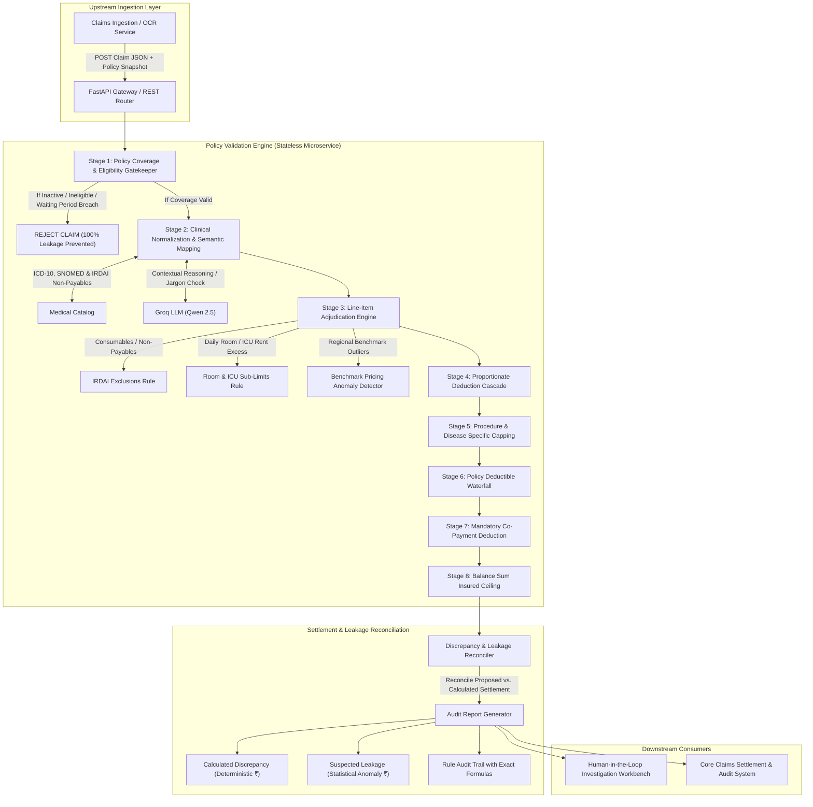
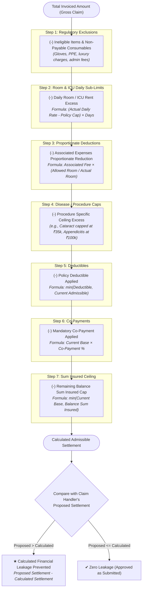
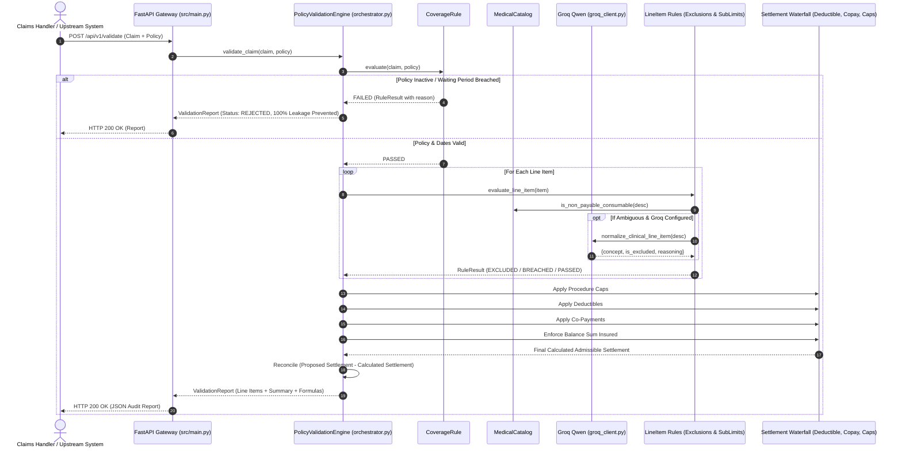

# Claims Policy Validation Microservice Architecture

> **AI for Insurance Claims Intelligence & Financial Leakage Prevention**  
> *Azentio Hackathon 2026*

---

## 1. High-Level System Architecture

This microservice is a **stateless, high-throughput claims validation and financial leakage prevention engine**. It consumes normalized claim payloads and policy terms, evaluates both line items and aggregate claims through a strict insurance financial waterfall, and produces audit-ready settlement reports.

---

## 2. Insurance Settlement Financial Waterfall Flow

The mathematical sequence of health insurance claim adjudication is critical. Applying deductions in the wrong order results in erroneous payouts. This engine enforces the standard IRDAI regulatory waterfall:

---

## 3. Component Architecture & Responsibilities

| Component | File Path | Core Functionality |
| :--- | :--- | :--- |
| **Config & Environment** | [`src/config.py`](file:///d:/Azentio_Hackathon/src/config.py) | Manages `.env` loading, Groq Qwen model selection, and paths to synthetic datasets. |
| **Data Contracts** | [`src/schemas/`](file:///d:/Azentio_Hackathon/src/schemas/) | Pydantic v2 schemas: `Policy`, `Claim`, `LineItem`, `RuleResult`, `ValidationReport`. |
| **Clinical Catalog** | [`src/catalog/medical_catalog.py`](file:///d:/Azentio_Hackathon/src/catalog/medical_catalog.py) | In-memory lookup with **word-boundary regex matching** to eliminate false positives (e.g. prevents matching `ppe` inside `appendectomy`). |
| **AI Clinical Agent** | [`src/ai/groq_client.py`](file:///d:/Azentio_Hackathon/src/ai/groq_client.py) | Connects to **Groq (`qwen-2.5-32b`)** for contextual clinical reasoning on complex or ambiguous medical descriptions. Fails over gracefully to catalog offline. |
| **Coverage Rule** | [`src/rules/coverage.py`](file:///d:/Azentio_Hackathon/src/rules/coverage.py) | Validates policy active status, date windows, covered dependents, 30-day initial waiting period, 24-month specific ailment waiting period, and 36-month pre-existing condition (PED) waiting period. |
| **Exclusion Rule** | [`src/rules/exclusions.py`](file:///d:/Azentio_Hackathon/src/rules/exclusions.py) | Flags IRDAI non-payable consumables (syringes, gloves, sanitizers, drapes) and administrative fees. |
| **Sub-Limit Rule** | [`src/rules/sub_limits.py`](file:///d:/Azentio_Hackathon/src/rules/sub_limits.py) | Computes room rent excess ($$\text{Daily Rate} > \text{Policy Cap}$$), ICU excess, and procedure-specific financial caps. |
| **Proportionate Deduction Rule** | [`src/rules/proportionate.py`](file:///d:/Azentio_Hackathon/src/rules/proportionate.py) | Contractual clause: if standard room rent is breached, associated surgeon, doctor, and nursing charges are reduced proportionally: $$\text{Ratio} = \frac{\text{Allowed Room Rate}}{\text{Actual Room Rate}}$$. |
| **Deductible Rule** | [`src/rules/deductible.py`](file:///d:/Azentio_Hackathon/src/rules/deductible.py) | Deducts per-claim or annual remaining deductible from the admissible base. |
| **Co-Payment Rule** | [`src/rules/copay.py`](file:///d:/Azentio_Hackathon/src/rules/copay.py) | Calculates and deducts contractual co-payment percentage (e.g. 10% or 20%). |
| **Benefit Limit Rule** | [`src/rules/benefit_limit.py`](file:///d:/Azentio_Hackathon/src/rules/benefit_limit.py) | Enforces remaining balance sum insured ceiling across the policy period. |
| **Benchmark Anomaly Rule** | [`src/rules/anomaly.py`](file:///d:/Azentio_Hackathon/src/rules/anomaly.py) | Flags provider procedure rates that exceed regional benchmarks as **Suspected Leakage** (requiring medical review, without breaking deterministic math). |
| **Waterfall Orchestrator** | [`src/engine/orchestrator.py`](file:///d:/Azentio_Hackathon/src/engine/orchestrator.py) | Executes all rules in strict waterfall order, compiles line-item audits, and reconciles financial leakage. |
| **Microservice Gateway & CLI** | [`src/main.py`](file:///d:/Azentio_Hackathon/src/main.py) | Provides FastAPI REST endpoints (`/health`, `/api/v1/validate`, `/api/v1/validate-demo/{id}`) and interactive Rich terminal CLI inspector. |

---

## 4. Sequence Diagram: Claim Validation Request

---

## 5. Distinction: Calculated Discrepancy vs. Suspected Leakage

As explicitly required by the hackathon problem statement:
- **Calculated Discrepancy (Deterministic ₹)**:
  - Exact mathematical overpayment resulting from objective policy terms.
  - Examples: Room rent overage ($$\text{Daily Rate} - \text{Limit} \times \text{Days}$$), non-payable consumables (gloves, PPE), co-payments, deductibles, or sum insured ceiling.
  - Handlers can automatically accept or apply this calculation.
- **Suspected Leakage (Statistical / Anomaly ₹)**:
  - Discrepancies resulting from provider price outliers (e.g. charging ₹1,25,000 for an appendectomy when the regional benchmark is ₹65,000).
  - The engine flags this as `ANOMALY_SUSPECTED` with the exact statistical delta ($$\text{Billed} - \text{Median}$$), keeping deterministic eligibility intact until a medical auditor approves or dismisses the finding.
