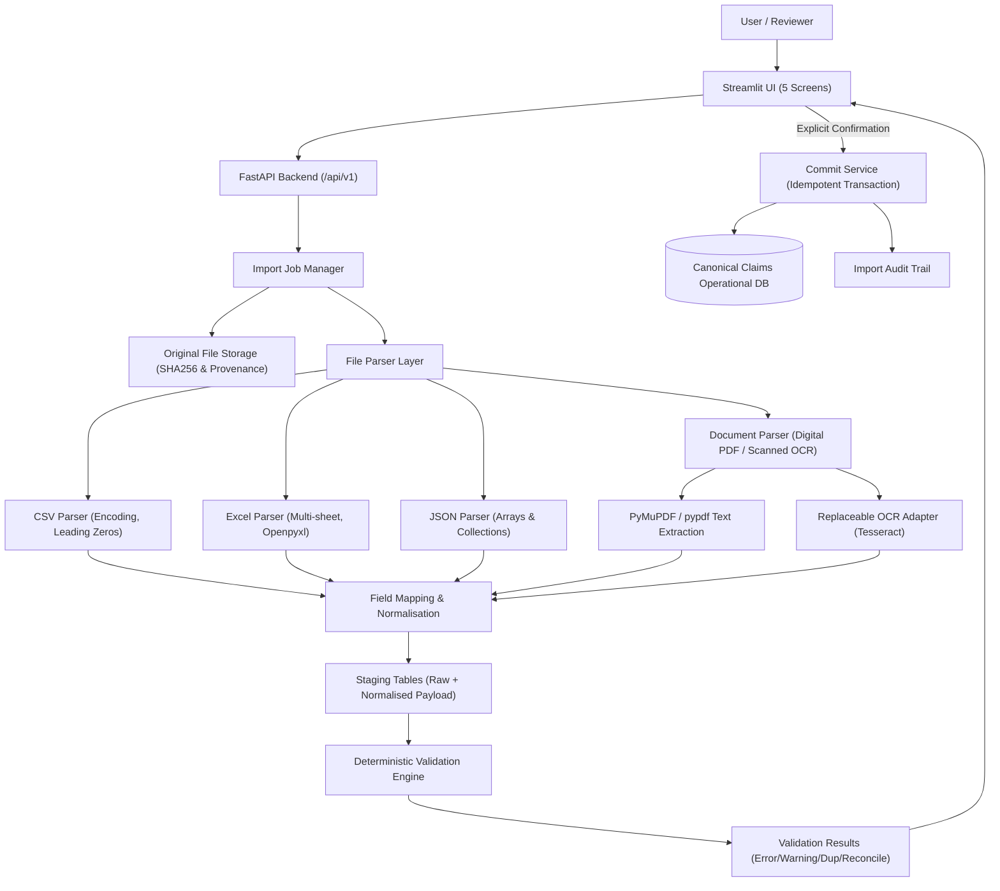

# Standalone Claims Data Ingestion Pipeline

[](https://www.python.org/downloads/)
[](https://fastapi.tiangolo.com/)
[](https://streamlit.io/)
[](https://www.sqlalchemy.org/)

A reliable, standalone health insurance claims data ingestion system that accepts structured data (CSV, Excel `.xlsx`, JSON) and sample documents (PDF, hospital bill images), validates them deterministically, reconciles outcomes without silent drops, and transactionally commits clean records into a canonical claims database.

---

## 1. Architecture Overview



---

## 2. Key Capabilities & RFC Compliance

1. **Multi-Format Structured Ingestion**:
   - **CSV**: Encoding auto-detection (UTF-8, Latin1, CP1252), leading zeros preserved, blank rows captured as `SKIPPED`.
   - **Excel (`.xlsx`)**: Multi-sheet extraction, row indexing, sheet-to-record-type mappings.
   - **JSON**: Arrays of records and named collections (`policies`, `claims`, `invoices`, `settlements`, `providers`, `line_items`, `history`).
2. **Deterministic Validation Engine**:
   - **Field & Schema**: Mandatory identifiers, supported claim types (`CASHLESS`, `REIMBURSEMENT`).
   - **Amount & Arithmetic**: `Decimal` precision for all currency values (no floats); non-negative checks; quantity > 0; line item total = quantity × unit price; invoice total = sum of line items within tolerance.
   - **Dates**: Format validation, `effective_from <= effective_to`, incident date within policy coverage, chronological checks.
   - **Referential Integrity**: Cross-record resolution within current bundle and database (order-independent).
   - **Duplicate Detection**: Duplicate claim IDs, duplicate invoices (provider + invoice reference), duplicate settlements, duplicate file hash detection.
3. **Reconciliation & No-Silent-Drop Guarantee**:
   $$\text{Parsed Records} = \text{VALID} + \text{WARNING} + \text{INVALID} + \text{DUPLICATE} + \text{PENDING\_REVIEW} + \text{explicitly SKIPPED}$$
   Every single source row is tracked with file, sheet, row, error code, message, and original payload.
4. **Document Ingestion & Replaceable OCR**:
   - Digital PDF extraction via PyMuPDF/pypdf.
   - Image & scanned document OCR using replaceable `OCRProvider` (implemented with Tesseract).
   - Candidate fields (invoice number, date, amount, hospital name) held in `PENDING_REVIEW` requiring explicit human review.
5. **Transactional Commit & Idempotency**:
   - Commits inside atomic database transaction with strict parent-before-child ordering (`Provider` $\to$ `Policy` $\to$ `Claim` $\to$ `Invoice` $\to$ `Line Items` $\to$ `Settlement` $\to$ `History`).
   - Re-checking on backend before commit; invalid/duplicate records are never committed.
   - Idempotent repeated commit calls with commit tokens.
6. **Built-in Synthetic Datasets**:
   - Small demo dataset with planted test cases (valid cashless/reimbursement, missing claimant, negative amount, unknown policy, duplicate claim, invoice mismatch).
   - Large dataset with 50+ claims for performance validation.
   - *Select Dataset invokes the exact same ingestion and validation pipeline as custom file uploads.*

---

## 3. Project Structure

```text
claims-ingestion/
├── app/
│   ├── main.py                  # FastAPI application entrypoint
│   ├── config.py                # Pydantic settings & directories
│   ├── api/
│   │   ├── routes/
│   │   │   ├── imports.py       # Import lifecycle APIs & CSV export
│   │   │   └── claims.py        # Canonical claim retrieval API
│   │   └── dependencies.py      # Database session dependency
│   ├── domain/
│   │   ├── enums.py             # ImportJobStatus, StagingRecordStatus, etc.
│   │   ├── canonical_models.py  # Pydantic domain models
│   │   └── schemas/             # Request & response models
│   ├── ingestion/
│   │   ├── job_manager.py       # Orchestration & file hashing
│   │   ├── parsers/             # CSV, Excel, JSON parsers
│   │   ├── mapping/             # Field mapping & alias resolver
│   │   ├── normalisation/       # Decimal, date, and string normaliser
│   │   ├── staging_service.py   # Staging records and updates
│   │   └── documents/           # PDF extractor & Tesseract OCR provider
│   ├── validation/
│   │   ├── engine.py            # Master validation engine & reconciliation
│   │   ├── field_validators.py  # Mandatory fields & types
│   │   ├── business_validators.py# Arithmetic & date validation
│   │   ├── referential_validators.py# Referential & cross-checks
│   │   └── duplicate_validators.py  # Bundle & DB duplicate checks
│   ├── persistence/
│   │   ├── database.py          # SQLAlchemy engine (Postgres/SQLite)
│   │   ├── models/              # Operational & import management tables
│   │   └── commit_service.py    # Transactional commit service
│   └── audit/
│       └── audit_service.py     # Audit event logger
├── ui/
│   └── streamlit_app.py         # 5-Screen Streamlit UI
├── sample_data/
│   ├── small/                   # Planted demo dataset
│   ├── large/                   # Performance dataset (50+ claims)
│   └── documents/               # Sample bill image & PDF
├── tests/
│   ├── unit/                    # Parser, validation, and document tests
│   └── integration/             # End-to-end pipeline & commit tests
├── run_tests.py                 # Test runner script
├── requirements.txt             # Dependencies
├── .env.example                 # Configuration template
└── README.md
```

---

## 4. Quick Start

### 1. Run the Automated Test Suite

```bash
cd /Users/meherchand/.gemini/antigravity/scratch/claims-ingestion
python3 run_tests.py
```
*Expected: 12 passed tests covering parsers, field validation, line arithmetic, dates, documents, and transactional commit.*

### 2. Start the FastAPI Backend

```bash
cd /Users/meherchand/.gemini/antigravity/scratch/claims-ingestion
PYTHONPATH=. uvicorn app.main:app --host 0.0.0.0 --port 8000 --reload
```
- Interactive Swagger API docs: [http://localhost:8000/docs](http://localhost:8000/docs)
- Health check: [http://localhost:8000/health](http://localhost:8000/health)

### 3. Launch the Streamlit User Interface

```bash
cd /Users/meherchand/.gemini/antigravity/scratch/claims-ingestion
PYTHONPATH=. streamlit run ui/streamlit_app.py --server.port 8501
```
Open [http://localhost:8501](http://localhost:8501) in your browser.

---

## 5. Walkthrough: The 5-Screen UI

1. **Screen 1: Import Dashboard**:
   - Click **"Load Synthetic Dataset"** (Small demo or Large dataset).
   - View previous jobs, statuses, and reconciliation counts.
2. **Screen 2: File Upload & Mapping**:
   - Upload multiple CSV, Excel, JSON, PDF, or image files.
   - Review detected formats and file sizes before initiating staging.
3. **Screen 3: Validation Results & Reconciliation**:
   - Summary cards: Valid, Warning, Invalid, Duplicate, Pending Review, Skipped.
   - Mathematical formula verification: `Parsed = Valid + Warning + Invalid + Duplicate + Pending Review + Skipped`.
   - Filter by status and record type.
   - Inline correction: edit JSON payloads directly in the browser and re-run validation on the fly!
   - Download the full **Validation Error Report (CSV)**.
4. **Screen 4: Document Review & OCR**:
   - View hospital invoice image/PDF.
   - Inspect OCR-extracted candidate fields and confidence scores.
   - Edit and confirm candidate values to promote them to validated staging records.
5. **Screen 5: Confirmation & History**:
   - Review eligible vs blocked record counts.
   - Explicit confirmation checkbox and warning acknowledgement input.
   - Click **"Commit Import to Operational Database"**.
   - Inspect the complete audit trail timeline.

---

## 6. REST API Endpoints

| Method | Endpoint | Purpose |
|---|---|---|
| `POST` | `/api/v1/imports` | Create import job and upload files |
| `POST` | `/api/v1/imports/sample-datasets` | Start import using built-in synthetic dataset |
| `GET` | `/api/v1/imports` | List import jobs |
| `GET` | `/api/v1/imports/{import_id}` | Get import status and reconciliation summary |
| `GET` | `/api/v1/imports/{import_id}/preview` | Preview staged records with pagination |
| `POST` | `/api/v1/imports/{import_id}/validate` | Run or rerun validation |
| `GET` | `/api/v1/imports/{import_id}/errors` | Get row-level errors and warnings |
| `GET` | `/api/v1/imports/{import_id}/errors/export` | Download validation error report as CSV |
| `PATCH`| `/api/v1/imports/{import_id}/records/{record_id}` | Correct a staged record |
| `POST` | `/api/v1/imports/{import_id}/commit` | Transactionally commit eligible records |
| `POST` | `/api/v1/imports/{import_id}/cancel` | Cancel an import |
| `GET` | `/api/v1/claims/{claim_id}` | Retrieve clean claim from operational DB |
